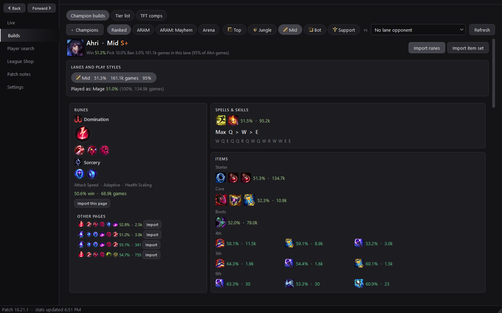
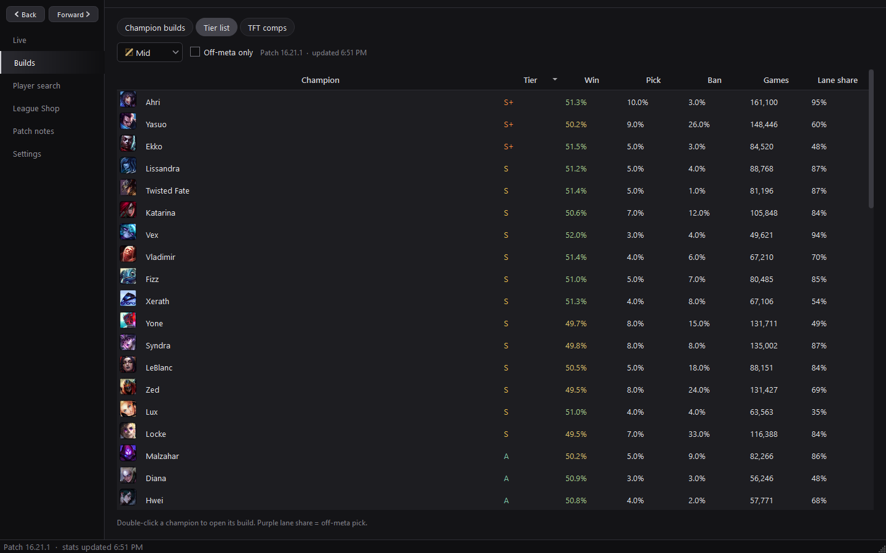
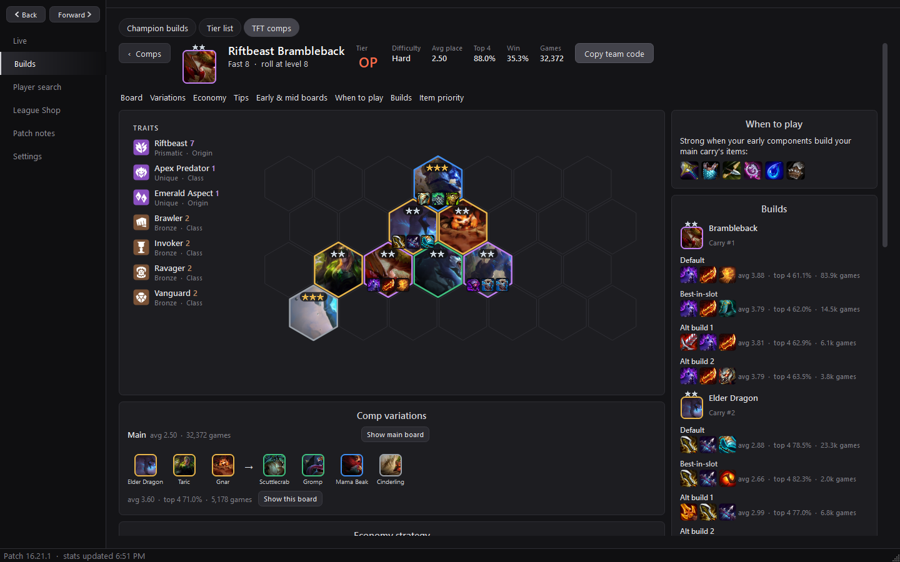
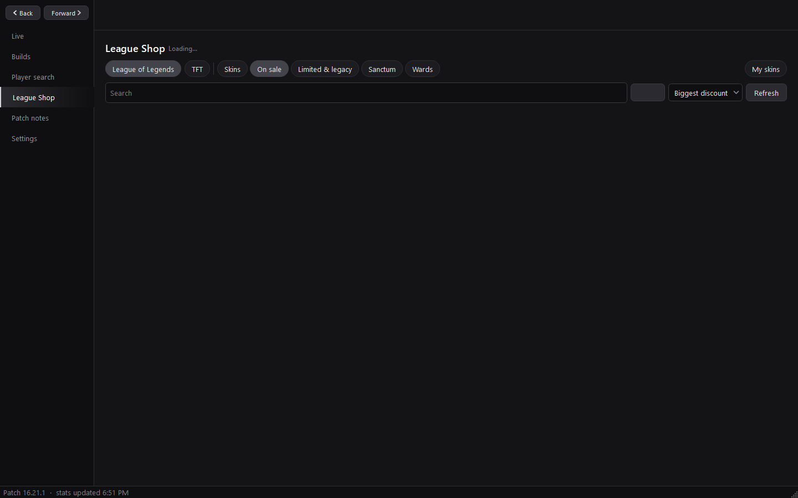
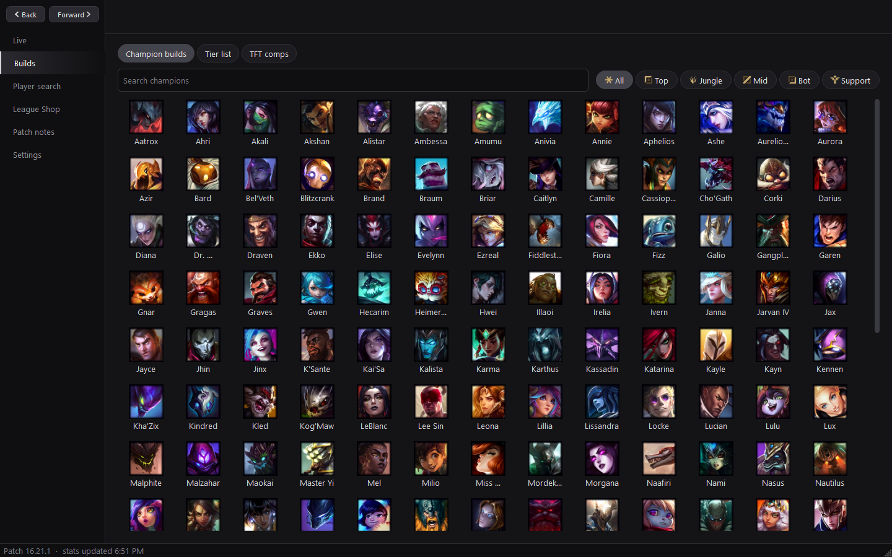
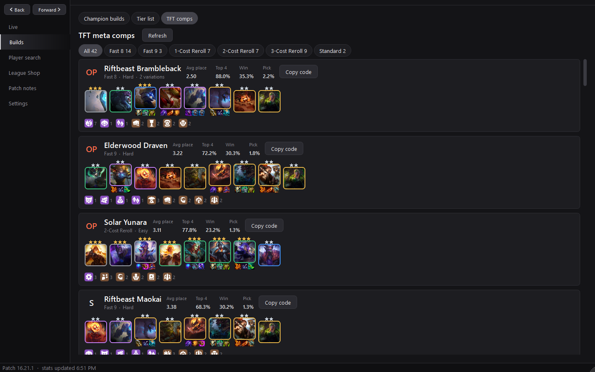
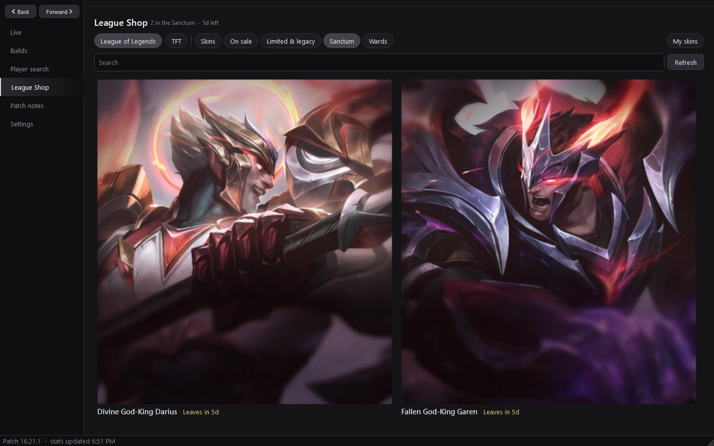
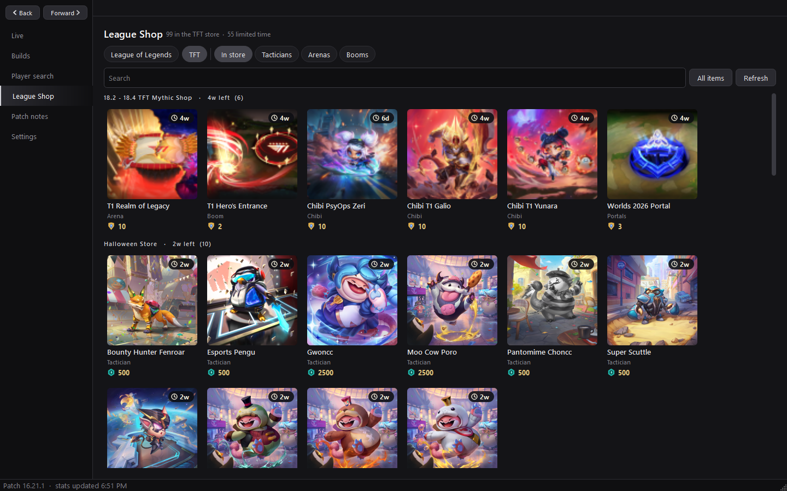
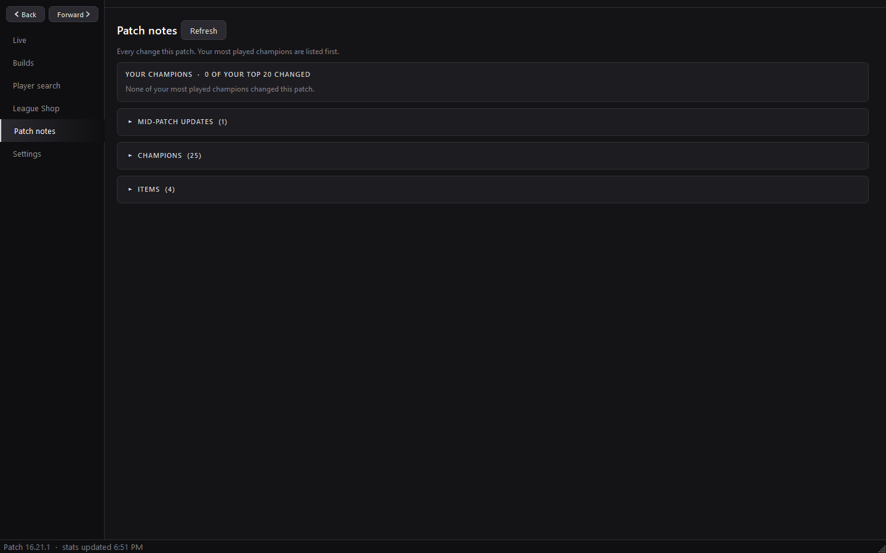
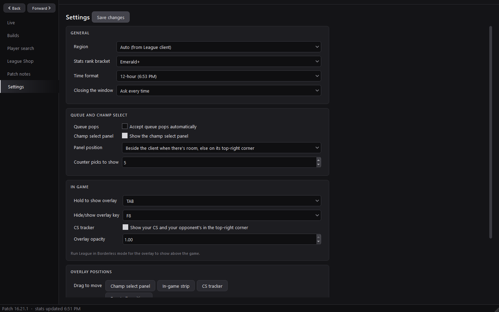

  

<h1 align="center">Feeferz Overlay</h1>

  A fast, lightweight League of Legends and TFT companion for Windows. 
  Builds, counters, tier lists, TFT comp guides, player profiles, the store and a minimal in-game overlay in one app.

  
  
  

  

## Download

1. Grab **`FeeferzOverlay.exe`** from the [latest release](https://github.com/RosieCozy/Feeferz-Overlay/releases/latest).
2. Run it. No installer and nothing else to install.
3. Set League to **Borderless** window mode so the overlay can show above the game.

The app updates itself when a new release is out. It waits until you're out of champ select or a game.

## Features

### Champ select, loading screen and in game
- Predicts your lane opponent as enemies lock in, with counter picks, your matchup win rate and the rune page that wins it.
- Runes and item sets import in one click. Imported rune pages are temporary: your own pages are never cluttered, and a page borrowed for the import is put back after the game.
- Loading screen: rank, win rate and champion stats for all 10 players, with flags for one-tricks, streaks, premades and players new to their champion.
- In game: your build against your lane opponent, the next item to buy and situational items based on the enemy team.
- A minimal, click-through overlay that never steals focus, plus an optional CS tracker for you and your lane opponent. Both adapt to ARAM and Arena.
- Optional auto-accept for queue pops.

### Builds and tier list

- Every champion's runes, spells, skill order and items, filtered by rank, plus the build into any opponent.
- Lane-specific tier and stats, every lane the champion is played in, and good/bad matchups.
- Ranked, ARAM, ARAM: Mayhem and Arena builds.
- A tier list per lane with win, pick and ban rates, and an off-meta filter.

### TFT comps

- Current meta comps with tier, average placement, top 4, win and pick rates, filtered by play style.
- A full guide for each comp: final board, traits, variations, economy plan stage by stage, tips, builds for every carry and item priority.
- Section links at the top of each guide, and a one-click team code for TFT's Team Planner.

### Player profiles
- Search any Riot ID. Your friends list and recent teammates show up first, with live in-game status.
- Ranks, season records, champion mastery, recent form at a glance and the last games with a grade and tags for each.
- Coaching insights that compare you with players in your role at your rank.
- Premades from recent games, and a flag when someone is new to the champion they're playing.

### League Shop

- Every skin with its price, the weekly sale, limited and legacy skins, the Sanctum, wards and your own collection.
- A TFT store with limited-time items, prices and filters for Tacticians, Arenas and Booms.
- RP, Blue Essence, Mythic Essence and TFT currencies shown just like the client.

### More
- Patch notes with your most played champions first.
- 12 or 24-hour time, close to tray or exit, and back/forward with the mouse side buttons.
- Light on older PCs: images download once, heavy sections load only when opened, and the app slows its polling down when minimized.

## Screenshots

| | |
| --- | --- |
|  |  |
|  |  |
|  |  |

## Is it safe?

Feeferz Overlay only uses the interfaces Riot provides on your own PC: the League client's local API (champ select, runes, store) and the Live Client Data API (your in-game items). It doesn't read or change game memory, inject anything or touch game files. No account login or API key is needed.

Enemy ability and summoner spell timers are deliberately left out, as Riot's third-party rules don't allow them.

## License

Copyright (c) 2026 Throwsie. All rights reserved.

Feeferz Overlay and its source code are owned by Throwsie. The code is public to view only. You may download and use the released app for personal use, but you may not copy, modify, redistribute, sell, re-upload or publish this code or the app, in whole or in part, or make derivative works from it, without written permission. See [LICENSE](LICENSE).

## Legal

Feeferz Overlay isn't endorsed by Riot Games and doesn't reflect the views or opinions of Riot Games or anyone officially involved in producing or managing Riot Games properties. Riot Games, and all associated properties are trademarks or registered trademarks of Riot Games, Inc.
